# 🚦 Automated Traffic Sign Recognition System for Autonomous Vehicles


An end-to-end computer vision and deep learning perception pipeline designed for Advanced Driver Assistance Systems (ADAS). The architecture normalizes environmental sensor degradations and classifies 43 distinct traffic sign categories in real time using a lightweight Convolutional Neural Network (CNN) optimized for edge compute.

---

## 📌 Problem Statement & Engineering Focus

Autonomous perception pipelines require deterministic, low-latency visual inference under safety-critical constraints. Standard classification models often fail in real-world driving environments due to:
* **Illumination shifts:** Heavy shadows, headlight glare, overexposure, and low-light nocturnal conditions.
* **Environmental noise:** Motion blur, weather occlusions, and off-axis camera angles.
* **Edge resource limits:** On-vehicle Electronic Control Units (ECUs) demand compact memory footprints and low computational overhead ($<10\text{ ms}$ inference).

This solution pairs an adaptive computer vision preprocessing pipeline with an 11-layer CNN ($378\text{K}$ parameters) that delivers **96.63% accuracy across 12,630 unseen benchmark test images** and supports zero-shot real-world generalization.

---

## 🏗️ End-to-End Pipeline Architecture

```mermaid
flowchart TD
    %% Styling Classes
    classDef io fill:#e3f2fd,stroke:#1565c0,stroke-width:2px,color:#0d47a1;
    classDef prep fill:#fff3e0,stroke:#e65100,stroke-width:1.5px,color:#bf360c;
    classDef cnn fill:#f3e5f5,stroke:#7b1fa2,stroke-width:1.5px,color:#4a148c;
    classDef dense fill:#e8f5e9,stroke:#2e7d32,stroke-width:1.5px,color:#1b5e20;
    classDef out fill:#fbe9e7,stroke:#c62828,stroke-width:2px,color:#b71c1c;

    %% Ingestion Stage
    subgraph S1 ["1. Sensor Frame Ingestion"]
        A["Input Image / Video Frame<br/>(32 × 32 × 3 RGB)"]:::io
    end

    %% Preprocessing Pipeline
    subgraph S2 ["2. Deterministic Preprocessing Pipeline"]
        B["Grayscale Conversion<br/><code>cv2.cvtColor</code> → (32 × 32 × 1)"]:::prep
        C["Contrast Normalization<br/><code>cv2.equalizeHist</code>"]:::prep
        D["Statistical Scaling<br/>Min-Max Normalization [0.0, 1.0]"]:::prep
    end

    %% Training Augmentation Stage
    subgraph S3 ["3. Dynamic Data Augmentation (Training)"]
        E["<code>ImageDataGenerator</code><br/>±10° Rotation | 10% Shift | 20% Zoom | 10% Shear"]:::prep
    end

    %% CNN Feature Extraction
    subgraph S4 ["4. Deep Convolutional Feature Extractor"]
        subgraph B1 ["Feature Block 1 (Edges & Contours)"]
            F["Conv2D (60 filters, 5×5, ReLU)<br/>Output: 28 × 28 × 60"]:::cnn
            G["Conv2D (60 filters, 5×5, ReLU)<br/>Output: 24 × 24 × 60"]:::cnn
            H["MaxPooling2D (2×2 pool)<br/>Output: 12 × 12 × 60"]:::cnn
        end
        subgraph B2 ["Feature Block 2 (Geometric Patterns)"]
            I["Conv2D (30 filters, 3×3, ReLU)<br/>Output: 10 × 10 × 30"]:::cnn
            J["Conv2D (30 filters, 3×3, ReLU)<br/>Output: 8 × 8 × 30"]:::cnn
            K["MaxPooling2D (2×2 pool)<br/>Output: 4 × 4 × 30"]:::cnn
            L["Spatial Dropout (Rate = 0.5)"]:::cnn
        end
    end

    %% Dense Classifier
    subgraph S5 ["5. Dense Classification Head"]
        M["Flatten Layer<br/>(480 Units)"]:::dense
        N["Fully Connected Dense<br/>(500 Units, ReLU)"]:::dense
        O["Dense Dropout (Rate = 0.5)"]:::dense
        P["Softmax Output Layer<br/>(43 Class Probability Distribution)"]:::dense
    end

    %% Output Stage
    subgraph S6 ["6. Perception Output (ADAS)"]
        Q["Class ID (0–42)<br/>Traffic Sign Label & Confidence (%)"]:::out
    end

    %% Connections
    A --> B
    B --> C
    C --> D
    D -.->|Training Phase| E
    E -.->|Augmented Batches| F
    D -->|Real-Time Inference| F
    F --> G
    G --> H
    H --> I
    I --> J
    J --> K
    K --> L
    L --> M
    M --> N
    N --> O
    O --> P
    P --> Q
```



---

## 🔬 Computer Vision Preprocessing

Raw RGB pixel feeds introduce computational overhead and vulnerability to sensor exposure variations. A 3-step deterministic transformation standardizes every frame prior to inference:

1. **Grayscale Conversion (`cv2.cvtColor`):** Road signs are primarily identified by geometric layout and iconography. Reducing depth from 3 channels to 1 reduces tensor bandwidth by 66%.
2. **Contrast Enhancement via Histogram Equalization (`cv2.equalizeHist`):** Redistributes pixel intensities to recover edge boundaries in underexposed or backlit images.
3. **Statistical Normalization:** Normalizes input range to $[0.0, 1.0]$, preventing exploding gradients and accelerating Adam convergence.

---

## 🧠 Neural Network Architecture

The network maximizes feature representation while maintaining a minimal memory footprint ($378,023$ trainable parameters / $1.44\text{ MB}$), enabling on-chip cache execution on embedded automotive hardware.

| Layer | Type | Output Shape | Kernel / Stride | Activation | Parameters | Function |
|---|---|---|---|---|---|---|
| **0** | `InputLayer` | `(32, 32, 1)` | — | — | 0 | Single-channel normalized tensor |
| **1** | `Conv2D` | `(28, 28, 60)` | $5 \times 5$ | ReLU | 1,560 | Primary boundary/edge extraction |
| **2** | `Conv2D` | `(24, 24, 60)` | $5 \times 5$ | ReLU | 90,060 | Local feature combinations |
| **3** | `MaxPooling2D`| `(12, 12, 60)` | $2 \times 2$ | — | 0 | Spatial subsampling & translation invariance |
| **4** | `Conv2D` | `(10, 10, 30)` | $3 \times 3$ | ReLU | 16,230 | Intermediate shape detection |
| **5** | `Conv2D` | `(8, 8, 30)` | $3 \times 3$ | ReLU | 8,130 | Complex pattern & symbol synthesis |
| **6** | `MaxPooling2D`| `(4, 4, 30)` | $2 \times 2$ | — | 0 | Subsampling & dimension reduction |
| **7** | `Dropout` | `(4, 4, 30)` | Rate = 0.5 | — | 0 | Spatial co-adaptation prevention |
| **8** | `Flatten` | `(480)` | — | — | 0 | Multi-dimensional tensor unrolling |
| **9** | `Dense` | `(500)` | — | ReLU | 240,500 | High-dimensional classification manifold |
| **10**| `Dropout` | `(500)` | Rate = 0.5 | — | 0 | Dense feature regularizer |
| **11**| `Dense` | `(43)` | — | Softmax | 21,543 | Probability distribution over 43 classes |

* **Loss Function:** Categorical Cross-Entropy
* **Optimizer:** Adam ($\alpha = 0.001$)
* **Batch Size:** 50 samples/batch ($696\text{ steps/epoch}$)

---

## 📊 Benchmark Dataset & Empirical Performance

Trained and evaluated on the **German Traffic Sign Recognition Benchmark (GTSRB)**:

| Dataset Partition | Samples | Input Dimensions | Modality |
|---|---|---|---|
| **Training Split** | 34,799 | $32 \times 32$ | Preprocessed Single-Channel |
| **Validation Split** | 4,410 | $32 \times 32$ | Preprocessed Single-Channel |
| **Held-Out Test Set** | 12,630 | $32 \times 32$ | Preprocessed Single-Channel |
| **Total Evaluation** | **51,839** | — | **43 Classes (IDs 0–42)** |

### Performance Metrics

* **Held-Out Test Accuracy:** **96.63%** across 12,630 unseen images.
* **Test Categorical Loss:** **0.1224**.
* **Validation Accuracy:** Peak **98.71%** (Validation Loss: **0.0479**).
* **Inference Latency:** $\sim 6\text{ ms}$ per sample on CPU ($\approx 160\text{ FPS}$), exceeding real-time ADAS constraints ($>30\text{ FPS}$).

---

## 🧪 Zero-Shot Real-World Image Verification

The pipeline was stress-tested against an uncurated external stock photograph (*"Turn left ahead"* sign) to evaluate out-of-domain transferability:
1. **ROI Extraction:** Cropped to isolate the sign from watermark noise and background clutter.
2. **Preprocessing:** Rescaled to $32 \times 32$, converted to grayscale, contrast-equalized, and normalized.
3. **Outcome:** Correctly classified as **Class 34 (*Turn left ahead*)** with high model confidence ($>90\%$).

---

## 🚀 Quickstart & Inference

### 1. Interactive Google Colab
Run the complete training, evaluation, and test suite directly in the cloud:
[Open In Colab](https://colab.research.google.com/drive/1NOomop4358GWzHPwfR7P4RsiGE_tK5Qm?usp=sharing)

### 2. Local Setup

```bash
# Clone repository
git clone [https://github.com/Ashish3692003/Automated-Traffic-Sign-CNN.git](https://github.com/Ashish3692003/Automated-Traffic-Sign-CNN.git)
cd Automated-Traffic-Sign-CNN

# Create virtual environment and install requirements
python -m venv venv
source venv/bin/activate  # Windows: venv\Scripts\activate
pip install tensorflow opencv-python numpy pandas matplotlib pillow requests
```

### 3. Inference Script

```python
import cv2
import numpy as np
from tensorflow.keras.models import load_model

def preprocess_image(img):
    gray = cv2.cvtColor(img, cv2.COLOR_BGR2GRAY)
    equalized = cv2.equalizeHist(gray)
    normalized = equalized / 255.0
    return normalized.reshape(1, 32, 32, 1)

# Usage
# model = load_model('traffic_sign_cnn.h5')
# processed = preprocess_image(cv2.imread('road_sign.jpg'))
# class_id = np.argmax(model.predict(processed))
```

---

## 🔮 Production Roadmap

* [ ] **Upstream Object Detection:** Integrate YOLOv8/v9 to detect and crop bounding-box ROIs from raw $1080\text{p}/4\text{K}$ automotive video streams.
* [ ] **Edge Hardware Quantization:** Convert model to **TensorFlow Lite (TFLite)** and **TensorRT** with INT8 post-training quantization for deployment on embedded NPUs, NVIDIA Jetson, and automotive FPGA accelerators.
* [ ] **Temporal Consensus:** Implement multi-frame majority voting across successive video frames to eliminate single-frame transient false positives.
---
## Project details
Project Document: [Automatic_TrafficSign_CNN](https://docs.google.com/document/d/1LEmtFMicuw9N9HQVssQ0dTs35cZ0WkiyP8VsKeblK5k/edit?usp=sharing) | 
Project Google Colab: [Google colab Notebook](https://colab.research.google.com/drive/1NOomop4358GWzHPwfR7P4RsiGE_tK5Qm?usp=sharing)

---
## 8. Author 
* **Ashish Nadh Varri** - [LinkedIn Profile](https://www.linkedin.com/in/ashishnadhvarri) • [GitHub](https://github.com/Ashish3692003)
